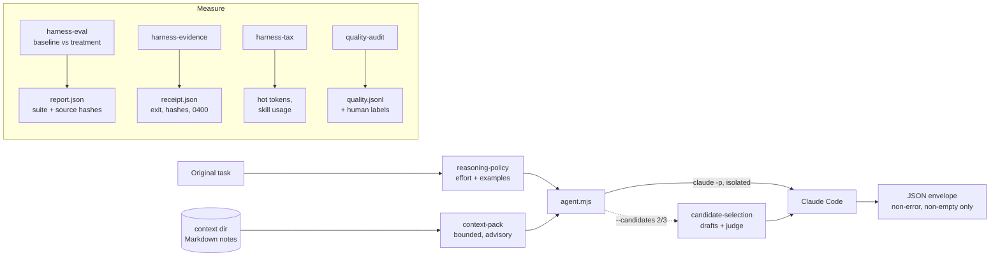

# Agent Harness Kit

Small, tested Node tools for improving the harness around Claude Code (the instructions, context, tools and checks around the model) and for measuring whether a change actually helped.

## Why

A model is the trained network; the harness is everything around it. Same weights in a different harness can score very differently, and most harness "improvements" are never measured. These tools come out of a personal agent setup that runs Claude Code headless on a schedule. Each one exists because of a specific failure:

- An agent's final message said "all tests pass" while the build had exited 1. → **execution receipts** record the real exit code, and printed `PASS` cannot override it.
- Prompt and routing changes were kept because they "felt better". → **baseline-vs-candidate evals** on fixed synthetic cases with exact grading, where a tie is reported as a tie.
- Sessions slowed down as rules, memory and plugin skill listings piled up. → a **harness-tax audit** of what loads before you type, and which skills were actually used.
- Applications sent by an agent drifted in quality weeks before any outcome showed it. → a **fresh-context quality judge** that never sees the agent's reasoning, with human labels to calibrate it.

## Features

- **`harness-evidence.mjs`**: runs a command without a shell and writes a JSON receipt: exit code, signal, timeout, duration, cwd, SHA-256 and byte counts of stdout/stderr. No output text is kept unless you ask (bounded tail). Receipt files are created exclusively (`wx`), set to mode 0400, and an existing receipt path refuses to run the command again. Timeouts kill the whole process group, including children that ignore SIGTERM.
- **`harness-eval.mjs`**: six fixed synthetic cases (stale deadline evidence, an ambiguous timed-out submit, a failed build with a success claim, an already-approved task, a constrained architecture choice, conflicting balances). Each runs as baseline (medium effort, no policy) and treatment (task-selected effort plus the reasoning policy), order counterbalanced, graded by exact JSON match. Reports carry a suite hash and source hashes, refuse to overwrite, and report partial results honestly on Ctrl-C.
- **`harness-tax.mjs`**: read-only audit of always-loaded files (`~/.claude/CLAUDE.md`, `~/AGENTS.md`, the project MEMORY.md) against a 2k-token budget, every user and plugin skill's listing cost, and how many were used in the last N days according to your Claude Code transcripts. Flags plugins with five or more skills and zero uses.
- **`agent.mjs`**: a headless Claude Code adapter. Read-only by default (Read/Grep/Glob only); execute mode runs Bash inside the OS sandbox with network denied and writes limited to declared roots. Every call uses `dontAsk`, zero MCP servers, no settings sources, no session persistence, and strips `ANTHROPIC_API_KEY` so a stray key never switches you to API billing. Only a non-error, non-empty JSON envelope counts as a result.
- **`reasoning-policy.mjs`**: picks low/medium/high effort from the original short task (not the assembled context), and attaches at most two worked examples for known failure patterns. Oversized or already-assembled prompts fall back to medium.
- **`candidate-selection.mjs`**: optional best-of-2 or best-of-3 for read-only drafts. Drafts are generated independently, then a judge call may pick one or reject all. Invalid judge output never produces a winner, and execution mode rejects multiple candidates.
- **`context-pack.mjs`**: pluggable personal context. Point `HARNESS_CONTEXT_DIR` at a folder of Markdown notes; files are capped per file and in total, marked old after 90 days, and injected once as advisory data that never grants permission. Ships with a fictional example in `context/example/`.
- **`quality-audit.mjs`**: samples recent submissions an agent sent, asks an isolated judge four pass/fail/unknown checks (truthful, complete, fit, professional) with structured output, and appends results to JSONL. You label checks by hand; the summary reports Wilson intervals and keeps true-pass and true-fail rates separate, and stays "uncalibrated" until at least 20 labels.
- **`skill/harness-improvement/SKILL.md`**: a Claude Code skill that tells an agent when and how to use all of the above, plus the edit loop, order of trust and promotion rules.

## How it works



The **edit loop** in the skill ties these together: rerun a real task that disappointed, propose edits that each quote the line they would fix, apply one edit per run, compare in a fresh context, keep only the winners, and log the losses too. The **order of trust** is: deterministic checks and golden examples gate, a fresh-context reviewer judges, self-critique is only a first draft of doubt.

## Tech stack

- Node.js 20.11+ (ES modules, `node:test`); no npm dependencies
- [Claude Code](https://docs.anthropic.com/en/docs/claude-code) CLI in headless mode (`claude -p --output-format json`) on your existing login
- macOS or Linux (process-group cleanup and the Bash sandbox assume POSIX)

## Getting started

```bash
git clone https://github.com/ianroyes-sys/agent-harness-kit.git
cd agent-harness-kit
npm test                     # 46 tests; no model calls, fake claude binaries only
```

Try each tool:

```bash
# Receipt for a real command
node scripts/harness-evidence.mjs --receipt /tmp/check-1.json -- npm test

# What would the adapter do with this task? (no model call, no context read)
node scripts/agent.mjs --inspect -p 'Debug the intermittent failure'

# Live adapter check (one haiku call, zero tools)
npm run agent:check

# Ask a read-only question with your own context folder
HARNESS_CONTEXT_DIR=~/notes/context node scripts/agent.mjs -p 'Which of my goals is most at risk this week?'

# Best-of-2 on a decision
node scripts/agent.mjs --read-only --model opus --task 'Pick a search approach' \
  -p 'Local-only, no recurring cost, working today. Options: ...' --candidates 2 --timeout-ms 260000

# Eval suite: offline inventory, then a live A/B run
npm run eval
npm run eval -- --live --model sonnet --output /tmp/ab-report.json

# What your harness loads before you type
npm run tax -- --days 30

# Quality judge on the bundled fictional submissions
node scripts/quality-audit.mjs run --dry --days 3650
node scripts/quality-audit.mjs run --days 3650
node scripts/quality-audit.mjs label <auditId> truthful fail
node scripts/quality-audit.mjs summary
```

Install the skill into Claude Code:

```bash
mkdir -p ~/.claude/skills && cp -r skill/harness-improvement ~/.claude/skills/
```

Then replace `$KIT` in the copied `SKILL.md` with the path to this checkout.

All environment variables are optional and listed in `.env.example`.

## Project structure

```
scripts/
  harness-evidence.mjs     Command receipts (exit, timeout, hashes)
  harness-eval.mjs         Baseline-vs-treatment synthetic eval
  harness-tax.mjs          Always-loaded context and skill-usage audit
  agent.mjs                Isolated headless Claude Code adapter
  reasoning-policy.mjs     Task-based effort and worked examples
  candidate-selection.mjs  Best-of-N drafts with an advisory judge
  context-pack.mjs         Pluggable Markdown context folder
  model-routing.mjs        Model tier aliases and legacy id mapping
  quality-audit.mjs        Fresh-context judge + human calibration
  *.test.mjs               node:test suites
skill/harness-improvement/ Claude Code skill: tools, edit loop, order of trust
context/example/           Fictional personal context (replace with your own)
data/example/              Fictional submissions for the quality judge
docs/
  ai-harness-concepts.md                    Ten AI concepts, what each means for a harness
  multi-harness-rl-and-q-agent-harness.md   What multi-harness RL research implies
  harness-upgrade.md                        The release notes and first measured results
```

## Status

In daily use: these scripts run inside the author's local agent dashboard, which drives scheduled Claude Code loops on a Mac. The first A/B run of the reasoning policy was a 6/6 vs 6/6 tie with about 21% more latency, and the docs say so. The quality judge is uncalibrated until it has human labels. Everything in `context/example/` and `data/example/` is fictional.

Built by [Ian Royes](https://github.com/ianroyes-sys)
